# Database design — Tana SPA

**Engine: PostgreSQL 17 on Supabase** (the remote project runs 17.11).
**Migrations:** `supabase/migrations/`, applied by the Supabase CLI. The first twelve are the original
`V1`…`V12` files (named `…_v1_foundation_and_identity.sql` and so on), followed by the Supabase ones.
**Verified by:** the pgTAP files in `supabase/tests/database/` (`npx supabase test db`), which run
against the local stack after every migration has been applied.

## Why PostgreSQL

| Need in this app | Why Postgres fits |
|---|---|
| Orders, payments, vouchers, stock must stay consistent | Real transactions + `CHECK` / `UNIQUE` / FK constraints, so a bug in app code can't corrupt money or stock |
| Vietnamese search ("Tìm kiếm dịch vụ / sản phẩm") | `unaccent` + `pg_trgm`: typing `cham soc da` finds `Chăm sóc da`, indexed |
| Flexible bits (notification payloads, gateway responses) | `jsonb`, without giving up the relational core |
| Business rules next to the data | Functions in SQL/PL/pgSQL run every rule inside the same transaction as the write |
| Cost/ops | Managed everywhere (Supabase, Neon, RDS, Cloud SQL), no vendor lock-in |

Rejected: **MongoDB** (this domain is highly relational — orders ↔ items ↔ products ↔ vouchers — and needs multi-row transactions);
**MySQL** (works, but weaker constraints/partial indexes/jsonb); **SQLite** is only used on the *client* (`core:cache`), never as the system of record.

## Conventions

- **IDs:** `uuid` (`gen_random_uuid()`). Safe to expose in URLs, no enumeration, can be generated client-side. Orders and bookings also get a short `order_no` / `booking_no` identity for receipts and support calls.
- **Money:** `bigint` in VND, column suffix `_vnd`. VND has no minor unit, so no decimals and no floating point.
- **Time:** `timestamptz`, stored in UTC; the client formats for Asia/Ho_Chi_Minh.
- **Enums:** `text` + `CHECK (… IN (…))` instead of `CREATE TYPE` — adding a value is a one-line migration, not an `ALTER TYPE` dance.
- **Snapshots:** `orders`/`bookings` copy names, prices, and addresses into their item rows. A later price change or deleted product never rewrites history.
- **Soft delete only for `users`** (`deleted_at`). Partial unique indexes mean a deleted account frees its email/phone.
- **`updated_at`** is maintained by a trigger, not by application code.

## Entity-relationship diagram

```mermaid
erDiagram
    users ||--o{ auth_identities : "signs in with"
    users ||--o{ refresh_tokens : has
    users ||--o{ user_addresses : saves
    users ||--o{ notifications : receives
    users ||--o{ device_tokens : "registers (push)"
    users ||--o{ favorites : "hearts"
    users ||--o| carts : owns
    users ||--o{ orders : places
    users ||--o{ bookings : makes
    users ||--o{ feedback : writes
    users ||--o{ user_vouchers : "holds (gift wallet)"
    users |o--o{ users : "referred_by"

    service_categories ||--o{ services : groups
    services ||--o{ combo_items : "combo contains"
    services ||--o{ branch_services : "offered at"
    branches ||--o{ branch_services : offers
    branches ||--o{ bookings : hosts
    bookings ||--|{ booking_items : includes
    services ||--o{ booking_items : "snapshotted into"

    products ||--|{ product_variants : "sold as"
    products ||--o{ product_images : has
    products ||--o{ favorites : "hearted"
    carts ||--o{ cart_items : contains
    product_variants ||--o{ cart_items : "added as"
    orders ||--|{ order_items : includes
    product_variants ||--o{ order_items : "snapshotted into"

    vouchers ||--o{ user_vouchers : "granted via"
    vouchers |o--o{ carts : "applied to"
    vouchers |o--o{ orders : "used on"
    vouchers ||--o{ voucher_redemptions : "audited by"
    orders ||--o{ payments : "paid by"
    bookings ||--o{ payments : "paid by"
    orders |o--o{ feedback : "reviewed in"
    bookings |o--o{ feedback : "reviewed in"
```



`v_user_history` (view) unions `orders` and `bookings` for the **Lịch sử** screen. `banners` is a standalone CMS table for the home carousel.

## Tables by screen

| Figma screen | Tables |
|---|---|
| **Login / Sign-up** | `auth.users` (Supabase Auth), `users`, `auth_identities` (Google, unused) |
| **Home** (greeting, tier, bell, banners, featured) | `users.membership_tier`, `notifications`, `banners`, `services.is_featured` |
| **Dịch vụ** (categories + search) | `service_categories`, `services`, `combo_items` |
| **Chi nhánh** | `branches`, `branch_services` |
| **Đặt lịch** *(inferred)* | `bookings`, `booking_items`, `payments` |
| **Shop** (grid, ♥, search) | `products`, `product_variants`, `product_images`, `favorites` |
| **Giỏ hàng** (cart, "Nhập mã giảm giá") | `carts`, `cart_items`, `vouchers` |
| **Hoàn tất đơn hàng** (checkout) | `orders`, `order_items`, `user_addresses`, `payments` |
| **Ưu đãi** (codes, "Quà của Anh") | `vouchers`, `user_vouchers`, `voucher_redemptions` |
| **Lịch sử** *(inferred)* | `v_user_history` over `orders` + `bookings` |
| **Feedback** *(inferred)* | `feedback` |

*Inferred* = I did not see that frame (Figma API rate limit); the tables come from the navigation labels and the other screens. Review them against the real designs.

## Decisions worth knowing

**Auth.** Supabase Auth owns credentials and sessions (`auth.users`). `users` is the profile, with the same `id`: a trigger on `auth.users` insert creates it as a `customer` and grants the welcome voucher, and another copies a confirmed phone across. `password_hash`, `refresh_tokens` and `phone_verifications` were dropped (`20261104161631_identity_on_supabase_auth.sql`). See `docs/adr/0007-backend-on-supabase.md`.

**Email/phone uniqueness.** Emails are stored lowercase (`CHECK email = lower(email)`, matching `AuthValidation.normalizeEmail`) and unique among *non-deleted* users only. Phone is stored as E.164 and is unique only among *verified* users (see V5 below): an unverified claim must not lock the real owner out.

**Cart.** One row per user in `carts` plus `cart_items` keyed `(user_id, variant_id)`, so "add" is an upsert and duplicates are impossible. Totals are computed from live prices, not stored; they are frozen only when the cart becomes an order.

**Checkout invariants live in the database:** `total = subtotal − discount + tax + shipping`, `discount ≤ subtotal`, stock can't go negative (two simultaneous checkouts can't oversell), and a cancelled status must carry `cancelled_at`.

**Vouchers.** One table covers typed promo codes, referral codes, and gifts (`kind`). `user_vouchers` is the "Quà của Anh" wallet; `voucher_redemptions` is the audit trail used to enforce `usage_limit` / `per_user_limit` **inside the checkout transaction**. Percent vouchers are 1–100 with an optional cap.

**Payments.** One row per attempt, COD included, so every method reconciles through one path. `UNIQUE (provider, provider_ref)` makes gateway webhooks idempotent. A payment targets exactly one of order/booking.

**Vietnamese search.** `app_unaccent()` is an `IMMUTABLE` wrapper around `unaccent` (the stock function is only `STABLE` and can't be indexed). Query with
`WHERE app_unaccent(lower(name)) LIKE '%' || app_unaccent(lower(:q)) || '%'` to use the trigram index.

**Foreign keys.** History is protected: users/branches/vouchers referenced by orders or bookings are `ON DELETE RESTRICT`; snapshot rows use `SET NULL` so a discontinued product doesn't break an old order.

## Not in this schema yet (deliberate)

- **Staff / technician scheduling and double-booking prevention.** The design doesn't show staff pick or slot capacity. When it does, add `staff` + a `btree_gist` exclusion constraint on `(staff_id, tstzrange(start_at, end_at))`.
- **Inventory movements ledger** (only `stock_qty` today).
- **Product categories**, **multi-currency**, **tax rates table** (tax is a stored amount, `0` in the design).
- **Per-type notification preferences** (mute promotions, keep order updates): the `notifications` feature flag is all-or-nothing per user today.
- **Row-level security policies** — RLS is enabled on every table with no policy, and table grants are revoked from `anon` and `authenticated`, so the Data API reads nothing directly. Authorization is done inside the `public` functions, each `security definer`, which are the only way in.

## Rollout plan

1. The database is the Supabase project `jnlonvutjugxxxsfpeom` (free plan, `ap-southeast-1`). Locally, `npx supabase start` runs the same Postgres in Docker.
2. Migrations reach the project only after `npx supabase test db` passes locally.
3. Never edit an applied migration — add a new file with `npx supabase migration new`.
4. Backups: check what the project's plan keeps before relying on it, and test a restore.

## Phone numbers and verification (V5)

Sign-up takes `phone` (Figma sign-up asks for it) in the Auth metadata. It is normalised to E.164 (`+84333433969`) by `AuthValidation.normalizePhone` in the app and `private.normalize_phone` in SQL, so `0333 433 969` and `+84 333-433-969` are the same number.

`users.phone` is **unique only among verified users** (`users_phone_verified_uq`). Otherwise anyone could register with a stranger's number and lock the real owner out. Supabase Auth sends and checks the codes; `phone_verifications`, which used to record each send, was dropped with the move. Full design: [`phone-verification.md`](phone-verification.md).

## Feature flags (V6)

Two tables let a feature be switched off while the system runs:

| Table | Holds |
|---|---|
| `feature_flags` | `key` → `enabled`: the state for everybody |
| `feature_flag_overrides` | `(flag_key, user_id)` → `enabled`: one user's exception, cascading on user delete |

A **missing row means "no opinion"**, not "off" — resolution falls through to the state compiled into the catalog, so clearing a row is an undo rather than an off switch. `flag_key` deliberately has **no** foreign key to `feature_flags`: an override must be settable for a flag with no global row, and a flag deleted from the code must not make these tables unwritable. The functions validate keys against `private.flag_catalog()` instead. V6 seeds `phone_otp_verification = false`.

Changes are made through the `/admin` portal by an account with `role = 'admin'`; none is seeded, so the first is promoted with SQL after signing up. Running the spa is the `owner` role instead ([`owner-role.md`](owner-role.md)). `updated_by` holds the acting administrator's id. Full design: [`feature-flags.md`](feature-flags.md).

## Push notifications (V8)

`device_tokens` holds one row per app install that asked to be notified.

| Column | Why it looks like that |
|---|---|
| `token` | The provider's registration token, **globally unique**. It identifies the *device*, not the account, so registering it moves it to the signed-in user with `ON CONFLICT (token) DO UPDATE`. Without that, the previous user of a shared phone keeps receiving the next user's notifications. |
| `platform` / `provider` | `android` / `ios` / `web` / `desktop`, and `fcm` — both `CHECK`-constrained, so an unknown value is a `400` from `register_device` rather than a silent row nobody can deliver to. |
| `last_seen_at` | Refreshed on every registration, so stale installs can be pruned. |

A row here is a cache, never a source of truth: the `push` function deletes any token FCM reports as
`UNREGISTERED` or `SENDER_ID_MISMATCH`. Everything cascades on user delete.

The same migration bounds `notifications.title` (1–120) and `body` (≤500) now that an API writes
them, and adds `sent_push_at` — a row with it null was stored but never pushed, which is a normal
state (no device, or no permission), not an error. Full design:
[`notifications.md`](notifications.md) and [`adr/0004-notifications-and-push.md`](adr/0004-notifications-and-push.md).

## Running it

```bash
npx supabase start -x logflare,vector,studio   # local Postgres on 127.0.0.1:54322, every migration applied
npx supabase db reset                          # replay from empty
npx supabase test db                           # the pgTAP suite
```

The migrations create the extensions they need (`pg_trgm`, `unaccent`, and `pg_cron` and `pg_net`
for reminders and push); Supabase allows all of them.
