# Database design — Tana SPA

**Engine: PostgreSQL 14+** (tested on 14.22; nothing in the schema needs a newer version).
**Migrations: Flyway**, in `server/src/main/resources/db/migration/` (`V1`…`V4`).
**Verified by:** `server/src/test/kotlin/com/tana/spa/db/MigrationsTest.kt` — applies every migration to a real
PostgreSQL and checks that the constraints reject bad data (`./gradlew :server:test`).

## Why PostgreSQL

| Need in this app | Why Postgres fits |
|---|---|
| Orders, payments, vouchers, stock must stay consistent | Real transactions + `CHECK` / `UNIQUE` / FK constraints, so a bug in app code can't corrupt money or stock |
| Vietnamese search ("Tìm kiếm dịch vụ / sản phẩm") | `unaccent` + `pg_trgm`: typing `cham soc da` finds `Chăm sóc da`, indexed |
| Flexible bits (notification payloads, gateway responses) | `jsonb`, without giving up the relational core |
| Ktor/Kotlin stack | First-class JDBC driver, Flyway, Exposed/jOOQ, Testcontainers |
| Cost/ops | Managed everywhere (Supabase, Neon, RDS, Cloud SQL), no vendor lock-in |

Rejected: **MongoDB** (this domain is highly relational — orders ↔ items ↔ products ↔ vouchers — and needs multi-row transactions);
**MySQL** (works, but weaker constraints/partial indexes/jsonb); **SQLite** is only used on the *client* (`core:cache`), never as the system of record.

## Conventions

- **IDs:** `uuid` (`gen_random_uuid()`). Safe to expose in URLs, no enumeration, can be generated client-side. Orders and bookings also get a short `order_no` / `booking_no` identity for receipts and support calls.
- **Money:** `bigint` in VND, column suffix `_vnd`. VND has no minor unit, so no decimals and no floating point.
- **Time:** `timestamptz`, stored in UTC; the client formats for Asia/Ho_Chi_Minh.
- **Enums:** `text` + `CHECK (… IN (…))` instead of `CREATE TYPE` — adding a value is a one-line migration, not an `ALTER TYPE` dance.
- **Snapshots:** `orders`/`bookings` copy names, prices, and addresses into their item rows. A later price change or deleted product never rewrites history.
- **Soft delete only for `users`** (`deleted_at`). Partial unique indexes mean a deleted account frees its email/phone.
- **`updated_at`** is maintained by a trigger, not by application code.

## Entity-relationship diagram

```mermaid
erDiagram
    users ||--o{ auth_identities : "signs in with"
    users ||--o{ refresh_tokens : has
    users ||--o{ user_addresses : saves
    users ||--o{ notifications : receives
    users ||--o{ favorites : "hearts"
    users ||--o| carts : owns
    users ||--o{ orders : places
    users ||--o{ bookings : makes
    users ||--o{ feedback : writes
    users ||--o{ user_vouchers : "holds (gift wallet)"
    users |o--o{ users : "referred_by"

    service_categories ||--o{ services : groups
    services ||--o{ combo_items : "combo contains"
    services ||--o{ branch_services : "offered at"
    branches ||--o{ branch_services : offers
    branches ||--o{ bookings : hosts
    bookings ||--|{ booking_items : includes
    services ||--o{ booking_items : "snapshotted into"

    products ||--|{ product_variants : "sold as"
    products ||--o{ product_images : has
    products ||--o{ favorites : "hearted"
    carts ||--o{ cart_items : contains
    product_variants ||--o{ cart_items : "added as"
    orders ||--|{ order_items : includes
    product_variants ||--o{ order_items : "snapshotted into"

    vouchers ||--o{ user_vouchers : "granted via"
    vouchers |o--o{ carts : "applied to"
    vouchers |o--o{ orders : "used on"
    vouchers ||--o{ voucher_redemptions : "audited by"
    orders ||--o{ payments : "paid by"
    bookings ||--o{ payments : "paid by"
    orders |o--o{ feedback : "reviewed in"
    bookings |o--o{ feedback : "reviewed in"
```

`v_user_history` (view) unions `orders` and `bookings` for the **Lịch sử** screen. `banners` is a standalone CMS table for the home carousel.

## Tables by screen

| Figma screen | Tables |
|---|---|
| **Login / Sign-up** | `users`, `auth_identities` (Google), `refresh_tokens` |
| **Home** (greeting, tier, bell, banners, featured) | `users.membership_tier`, `notifications`, `banners`, `services.is_featured` |
| **Dịch vụ** (categories + search) | `service_categories`, `services`, `combo_items` |
| **Chi nhánh** | `branches`, `branch_services` |
| **Đặt lịch** *(inferred)* | `bookings`, `booking_items`, `payments` |
| **Shop** (grid, ♥, search) | `products`, `product_variants`, `product_images`, `favorites` |
| **Giỏ hàng** (cart, "Nhập mã giảm giá") | `carts`, `cart_items`, `vouchers` |
| **Hoàn tất đơn hàng** (checkout) | `orders`, `order_items`, `user_addresses`, `payments` |
| **Ưu đãi** (codes, "Quà của Anh") | `vouchers`, `user_vouchers`, `voucher_redemptions` |
| **Lịch sử** *(inferred)* | `v_user_history` over `orders` + `bookings` |
| **Feedback** *(inferred)* | `feedback` |

*Inferred* = I did not see that frame (Figma API rate limit); the tables come from the navigation labels and the other screens. Review them against the real designs.

## Decisions worth knowing

**Auth.** `password_hash` is nullable (Google-only accounts). `refresh_tokens` stores only a SHA-256 hash and a `family_id`, enabling rotation with theft detection (a reused, already-revoked token revokes the whole family). The current server issues 1-hour access JWTs and no refresh token yet — this table is the plan for that.

**Email/phone uniqueness.** Emails are stored lowercase (`CHECK email = lower(email)`, matching `AuthValidation.normalizeEmail`) and unique among *non-deleted* users only. Phone is stored as E.164 and is unique only among *verified* users (see V5 below): an unverified claim must not lock the real owner out.

**Cart.** One row per user in `carts` plus `cart_items` keyed `(user_id, variant_id)`, so "add" is an upsert and duplicates are impossible. Totals are computed from live prices, not stored; they are frozen only when the cart becomes an order.

**Checkout invariants live in the database:** `total = subtotal − discount + tax + shipping`, `discount ≤ subtotal`, stock can't go negative (two simultaneous checkouts can't oversell), and a cancelled status must carry `cancelled_at`.

**Vouchers.** One table covers typed promo codes, referral codes, and gifts (`kind`). `user_vouchers` is the "Quà của Anh" wallet; `voucher_redemptions` is the audit trail used to enforce `usage_limit` / `per_user_limit` **inside the checkout transaction**. Percent vouchers are 1–100 with an optional cap.

**Payments.** One row per attempt, COD included, so every method reconciles through one path. `UNIQUE (provider, provider_ref)` makes gateway webhooks idempotent. A payment targets exactly one of order/booking.

**Vietnamese search.** `app_unaccent()` is an `IMMUTABLE` wrapper around `unaccent` (the stock function is only `STABLE` and can't be indexed). Query with
`WHERE app_unaccent(lower(name)) LIKE '%' || app_unaccent(lower(:q)) || '%'` to use the trigram index.

**Foreign keys.** History is protected: users/branches/vouchers referenced by orders or bookings are `ON DELETE RESTRICT`; snapshot rows use `SET NULL` so a discontinued product doesn't break an old order.

## Not in this schema yet (deliberate)

- **Staff / technician scheduling and double-booking prevention.** The design doesn't show staff pick or slot capacity. When it does, add `staff` + a `btree_gist` exclusion constraint on `(staff_id, tstzrange(start_at, end_at))`.
- **Inventory movements ledger** (only `stock_qty` today).
- **Push device tokens**, **product categories**, **multi-currency**, **tax rates table** (tax is a stored amount, `0` in the design).
- **Row-level security** — authorization is done in the API layer.

## Rollout plan

1. Provision PostgreSQL 16/17; create two roles: a **migration role** (owns schema, used by Flyway) and an **app role** (`SELECT/INSERT/UPDATE/DELETE` only, no DDL).
2. **Done:** Hikari + Flyway + a plain-JDBC `PostgresUserRepository` / `PostgresPhoneVerificationRepository` sit behind the `UserRepository` / `PhoneVerificationRepository` interfaces (chosen over Exposed: a handful of queries doesn't justify an ORM). Select Postgres by setting `DATABASE_URL`.
3. Run Flyway on startup in dev; in production run it as a separate deploy step.
4. Config via env: `DATABASE_URL`, `DATABASE_USER`, `DATABASE_PASSWORD` (never in source).
5. Backups: enable point-in-time recovery on the managed instance; test a restore.
6. Never edit an applied migration — add `V5__…sql`. Flyway checksums will fail the build if you do.

## Phone numbers and verification (V5)

`POST /register` takes `phone` (Figma sign-up asks for it). It is validated worldwide with libphonenumber and stored as E.164 (`+84333433969`), so `0333 433 969` and `+84 333-433-969` are the same number.

`users.phone` is **unique only among verified users** (`users_phone_verified_uq`). Otherwise anyone could register with a stranger's number and lock the real owner out. The `phone_verifications` table records each code that was sent (never the code itself) to drive cooldowns, caps and per-country fraud monitoring. Full design: [`phone-verification.md`](phone-verification.md).

## Running it

| Variable | Meaning |
|---|---|
| `DATABASE_URL` | `jdbc:postgresql://host:5432/tana_spa`. **Unset = in-memory mode** (accounts lost on restart). |
| `DATABASE_USER`, `DATABASE_PASSWORD` | the app role |
| `DATABASE_POOL_SIZE` | default 10 |
| `DATABASE_MIGRATE=false` | skip Flyway at startup (when migrations run as a deploy step) |
| `APP_ENV=production` | refuses to start without `DATABASE_URL` and `JWT_SECRET` |

Flyway needs `CREATE EXTENSION` for `pg_trgm` and `unaccent` (both "trusted" extensions on PostgreSQL 13+, so the database owner can create them; managed hosts allow them).
